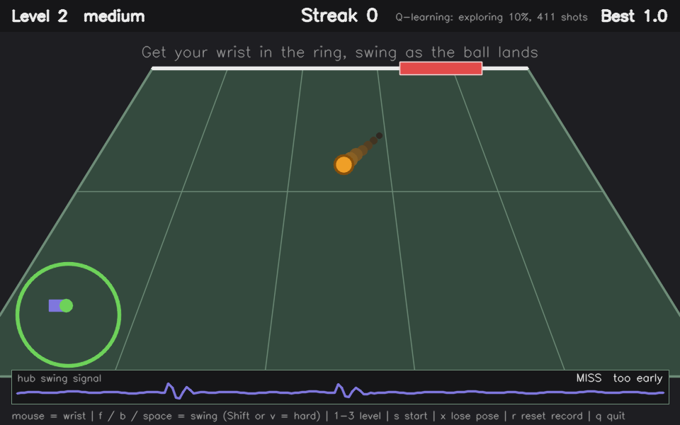

# Virtual ping-pong (live game, simulator, learning opponent, swing recognizer)

You hold the hub like a paddle. A virtual ball flies at you, you get your wrist
into the landing ring and swing, and your shot flies back at a virtual
opponent who has to chase it. Your best streak of continuous hits is
published to `ME193/Rogers/<YourName>` as a float, like `7.0`.

`pingpong_live.py` is the **real game**: webcam pose for the paddle position,
AprilTag cards for the level and the start, the hub's IMU for the swing, haptics on
the hub, and the score on MQTT. `pingpong_sim.py` is the same game with a mouse and
keyboard standing in for the sensors. Both drive the same rules (`pingpong_core.py`),
so everything tested in the simulator holds in the live game.

## Play it live

```bash
pip install -r requirements.txt
python make_cards.py                       # print cards.pdf at 100%: START + LEVEL 1/2/3
python mqtt_check.py --name YourName       # once: proves the score reaches test.mosquitto.org
python pingpong_live.py --name YourName    # play
```

1. **Grip:** the hub in your **right** hand, blue side against your palm (the grip the
   swing model learned). For the buzz, push something lopsided onto the **left** motor
   shaft (a beam or a few bricks off-center).
2. **Calibrate:** stand so the camera sees you from the waist up, hold the hub where a
   comfortable hit is, and press **C**. That spot becomes the middle of the hitting line
   (saved in `live_settings.json`). If you have to reach too far side to side, press
   **[**; if the paddle zips across too easily, **]**.
3. **Start:** show a LEVEL card (1, 2 or 3), then the START card. 3-2-1.
4. **Play:** the hub turns yellow when a ball is coming. Move your wrist into the ring
   (it turns green on screen), and swing as the ball lands: the hub turns green just
   before the swing window opens. A hit buzzes and beeps; a miss rumbles.

The screen shows the court, a camera preview (your skeleton, the cards it reads, and
the hitting line and ring drawn in *your* space), what the hub last recognized, and
how early or late your swings are. Each session saves `live-<time>-events.csv` (every
game event and swing, with timing) and `live-<time>-stream.csv` (every IMU reading).

| Key | Does |
|---|---|
| `C` | calibrate the hitting line to where your wrist is now |
| `[` / `]` | less / more reach needed to cover the court |
| `1` `2` `3` / `S` | level / start, if a card won't read |
| `R` | reset the record |
| `Q` / Esc | quit (saves the Q-table and the logs) |

**Each part can be tried on its own:** `--no-camera` (mouse = wrist, keys = cards),
`--no-hub` (keys F / B / Space = swings), `--fake` (synthetic hub), `--keys` (keyboard
swings allowed alongside the hub), `--no-haptics`, `--no-sound`, `--opponent rule`.

**Before game day, check the buzz:** `python pingpong_live.py --check-haptics`. Hold the
hub still; it plays each buzz 5 times and counts whether the swing recognizer ever
mistakes one for a swing. Buzzes only happen right after a hit or a miss, when the game
isn't listening for swings, but this proves it on your hub.

### How the live inputs work

- **Pose (`pose_input.py`).** MediaPipe PoseLandmarker, the Tasks API from HW1
  (`pose_landmarker_lite.task`, downloaded on the first run). It runs on the unmirrored
  frame so "right wrist" really is your right wrist, then mirrors x for display. A
  one- or two-frame dropout is ridden out (0.25 s); a longer one freezes the ball.
- **Cards (`tag_input.py`).** OpenCV ArUco with `DICT_APRILTAG_36h11`, as in HW2. A card
  counts after 3 frames in a row; the start card fires once per showing. Cards are only
  read while idle, so flashing one mid-rally does nothing.
- **Swings (`hub_input.py`).** The hub is read on its own thread (nothing can pause the
  reading) through the same recognizer `swing_check.py` scored. A swing's `age` is
  measured when the game picks it up, from the swing's peak, so the ~0.26 s recognition
  delay plus the camera frame are both compensated; the game waits 0.3 s
  (`LIVE_SWING_REPORT_DELAY`) before calling "no swing".
- **Haptics (`haptics.py`).** Every hub command is sent with `blocking=False` from a
  worker thread with a short queue, so the game never waits on the hub.
- **Score (`score_publisher.py`).** Checks that the broker really confirmed the
  connection; a record set while the broker is unreachable is held and sent when it
  comes back. The screen shows `MQTT ok` or `MQTT waiting for broker`. The score is
  retained, so a dashboard that connects late still sees it.
- **Shot direction.** For a right-hander, a forehand goes left and a backhand right
  (`--flip-shots` if it feels backwards).

## The simulator



## Run it

```bash
pip install -r requirements.txt
python pingpong_sim.py --name YourName                       # play it yourself
python pingpong_sim.py --name YourName --opponent q          # an opponent that learns your weaknesses
python pingpong_sim.py --name YourName --bot --no-mqtt       # watch a scripted player
python test_core.py && python test_q.py && python test_imu.py && python test_swing.py && python test.py && python test_live.py   # 142 headless tests
```

The MQTT broker is `test.mosquitto.org`, the one the class uses (`--broker` to change it).

## Controls

| Input | Stands in for | Does |
|---|---|---|
| mouse | MediaPipe wrist | where your paddle is |
| `f` / `b` / space | hub IMU + swing classifier | forehand / backhand / flat swing |
| Shift+`f` / Shift+`b` / `v` | the same, harder | more power |
| `1` `2` `3` | AprilTag level card | easy / medium / hard (only while idle) |
| `s` | AprilTag start card | start with a 3-2-1 countdown |
| `x` | tracking dropout | toggles "pose lost" |
| `r` | | reset the record |
| `q` / Esc | | quit |

## The rules

1. The opponent serves. The ball flies toward a landing ring on your side.
2. A swing counts as a **hit** only if both are true: the swing's peak lands within
   the timing window of the ball's arrival (the IMU part: ±0.30 s on level 1,
   ±0.20 s on level 2, ±0.15 s on level 3), and your wrist was inside the ring
   during the 0.3 s before the swing (the pose part; the swing itself is allowed
   to carry your hand out).
3. Your swing type picks the direction (forehand right, backhand left, flat
   straight) and the power sets the speed. Being nearer the ring center aims
   more accurately.
4. The opponent reads your shot, waits its reaction time, and slides toward
   it. If it reaches the ball it hits it back at a new landing zone. If not,
   you win the point.
5. **Streak** counts your consecutive hits. A winner keeps it going; only a
   miss resets it. The published score is the best streak.

A miss happens when you don't swing, swing too early, or swing from outside
the ring. After any swing there's a 0.4 s cooldown, so spamming the swing key
doesn't work.

## The learning opponent (`--opponent q`)

A Q-table, like Silly Walks:

| | |
|---|---|
| state | where you're standing: 5 zones, plus a "serving" state (6 rows) |
| action | where to aim (5 zones) × slow or fast (10 columns) |
| reward | +1 when you miss its shot, −0.2 when you return it |

After each shot: `Q(s,a) = (1−α)·Q(s,a) + α·(reward + γ·max Q(s'))`, with
α = 0.25, γ = 0.6. It picks the best-known action most of the time and a
random one with probability ε, which starts at 0.6 and shrinks by 0.98 per
shot. The table is saved to `qtable_<name>.json`, so it remembers you between
sessions. At exit it prints what it learned about you in words.

**Guardrails**, so a good learner doesn't make the game unplayable: ε never
falls below 0.10 (it keeps checking whether you've improved), fast shots only
where the level allows them, and after 3 misses in a row it serves an easy,
slow ball right at you (and doesn't learn from that forced shot).

**Does it learn?** `python eval_opponent.py` plays a scripted player with a
known weakness (bad at zone 0, worse at fast shots) against each opponent.
Percent of shots the player misses, mean of 5 seeds:

| opponent | shots 1-100 | shots 701-800 |
|---|---|---|
| random | 27 | 25 |
| rule-based | 35 | 36 |
| Q-learning, guardrail off | 57 | 66 |
| Q-learning, guardrail on | 53 | 66 |

It finds the planted weakness: the learned table aims mostly at zone 0, and
mostly fast. The best possible opponent here would get about 80%, so it isn't
perfect (it explores 10% of the time, and "where you stand" isn't what this
particular bot is weak on, which spreads the data thin). This is a bot with
one simple weakness. A human's weaknesses are fuzzier, so expect a smaller
effect, and judge it by playing.

To watch it learn on screen:
`python pingpong_sim.py --bot --bot-weak --opponent q --no-mqtt`.

## The IMU recorder (needs your hub)

`imu_recorder.py` does two jobs with the real hub in your hand. Everything in
it was tested against a fake hub, so the only hub-specific code is a few lines
in `imu_hub.py` (reading `imu_device`, the beep and light cues, one motor
twitch). If a cue or the motor twitch fails on your hub, it prints a warning and
carries on. If the IMU itself can't be read, it stops with a clear message.

**1. Probe: how fast can the IMU data come in?**
```bash
python imu_recorder.py --probe
```
On the first real run, the hub sent about 9.6 IMU readings a second (one
bundle of IMU + gesture + both motors roughly every 100 ms), which is too slow
to time a swing. LEGO's API has `device_notification_request(delay_ms)`, which
sets how often the hub sends those bundles (15 to 1000 ms). The probe asks for
100, 50, 30, 20 and 15 ms in turn, measures what really arrives, and tells you
the fastest setting the hub kept up with. Asking for a rate isn't the same as
getting it, since Bluetooth may not keep up, which is why it measures. It then
runs a swing-size check: how big your swings are compared with resting noise,
giving you a swing threshold. If your swings are too weak to measure, it says so
instead of suggesting one.

An optional round-trip delay test twitches the left motor and times how long
until the IMU notices. A bare motor shaft is too light to move the hub, so it
only works with something lopsided on the shaft; skip it otherwise.

**2. Record: swings to train a classifier on.**
```bash
python imu_recorder.py --record --notify-ms 20     # use the value the probe recommended
```
It walks you through 30 forehands, 30 backhands, 30 flat shots, plus 10
stillness, 15 shakes and 10 walking takes (the things a classifier must learn
not to call a swing). The hub's light is yellow for get-ready and green with a
beep for go. A swing that comes out too weak is rejected and redone. Ctrl+C
stops early and keeps what's saved; sessions append to `swings.csv`. Check what
you've got with `python imu_recorder.py --summary swings.csv`.

The default window is 2.5 s per take. The first recording used 1.5 s, and in 34 of
90 swing takes the main swing landed in the first or last quarter-second, so it was
cut off. Swing naturally around the beep; the exact moment doesn't matter.

## Swing recognition from the IMU

`swing_detect.py` finds swings in the hub's reading stream and says which kind;
`train_swing_classifier.py` trains it from `swings.csv`. Training and live use share
the same detector code, so the model is trained on exactly what it sees in play.

**What the recordings showed, which shaped the design**

- A hand holding the hub is never still. Between swings the gyro sits around
  100 to 300, versus about 5 on a table, so a fixed threshold either fires
  constantly or misses gentle swings. The detector's threshold adapts to how
  much you're moving (a reading must be the largest nearby, above 100, and above
  1.5× the recent movement level).
- Forehand and backhand rotate the hub opposite ways (a forehand's main
  rotation is positive about the hub's y-axis, a backhand's negative). Flat is a
  small wrist push, a much smaller motion.
- Shaking is the hard confound: at any threshold you can't catch most swings
  without also catching most shakes. That's why a classifier follows the
  detector, and why shakes are recorded as examples of "not a swing".

**Results.** Training prints cross-validation (92%, against 41% for always guessing the
biggest class), but that number alone proved misleading, so the ones to believe are
scored on runs the model has never seen (`python eval_runs.py`). Each line below is one run
scored by a model trained on the recording plus the OTHER three runs:

| Run (the unseen one) | Swings the right kind | False alarms in 45 s |
|---|---|---|
| 1: continuous swinging, no cues | 28 of 30 | 0 |
| 2: continuous swinging, with cues | 27 of 30 | 0 |
| 3: waiting for each cue (how the game looks) | 26 of 30 | 0 |
| 4: waiting for each cue | 29 of 30 | 0 |
| **average** | **92%** (110 of 120) | **0 in 3 minutes** |

Run 3 scored only 20 of 30 when it was the one still-hand run, because the model had no
still-hand examples of its own to learn from; with run 4 as a second one it scores 26. So a
new session in the same style is handled, and a style the model has never seen is the weak
spot. A short calibration run (`python swing_check.py`, then retrain with it) is the fix.

Run 4 was also a true fresh test of the model as it stood: trained on runs 1 to 3 only, it
scored **29 of 30 with 0 false alarms**, against 13 of 30 for the first model and 15 of 30
for the shape-only model trained on the recording alone, on the same run. The shipped model
now also trains on run 4, so it can't be scored on any of the four; the next fresh run is
the test.

Honest limits of that evidence: 120 swings (about 92%, plausibly anywhere from 85% to 96%),
and only 3 minutes of random movement in total, so zero false alarms is compatible with up
to roughly 1 a minute. One player, one day, one grip. Training on the more varied runs also fits the original
recording a little less tightly (88% agreement on its swings above the minimum size, against
91% for the model trained on three runs): the price of the better scores on unseen runs. The minimum swing size is also a tight
fit: across the still-hand runs ordinary movement peaked at most 309 and the weakest real swing
at 373, with the floor at 330 in between. A bigger sweep of the arm between balls could exceed it.

**The accept rule (run 5, beam on).** With the haptic beam attached, `swing_check.py` scored
25 of 30 with 0 false alarms, and all 5 lost swings had the same cause: the model was sure it
was a swing but split between two kinds (best kind at 0.50-0.58, under the 0.6 cutoff). In
the game that's backwards: an ignored swing is a miss, while the wrong kind only aims the
shot differently. So the recognizer now accepts an event when **P(forehand) + P(backhand) +
P(flat) >= 0.9** (the "swing rule") and names it by the likeliest kind. `python eval_rules.py`
scores all five runs, each with a model that never saw it:

| rule | swings accepted | named right | false alarms (random + breaks) |
|---|---|---|---|
| kind >= 0.6 (old) | 92.0% | 90.7% | 0 + 1 |
| swing >= 0.9 (new) | **98.0%** | **95.3%** | **0 + 0** |

On run 5 itself, the same model goes from 25/30 to 29/30. Why 0.9: every one of 147 real
swings scored at least 0.965, and the one non-swing movement that got past the size floor
(a 373 bump during a break) scored 0.848. In these runs no random movement reached the size
floor at all, so the floor does most of the swing/non-swing work and the cutoff catches the
rest. `--rule kind` brings back the old rule in every tool.

**Model files.** `swing_model.json` is unchanged (trained on the recording plus runs 1-4) and
`swing_model_v1.json` is an identical backup. `swing_model_v2.json` also learned from run 5
(beam on); it can't be fairly scored yet because it has seen every run. On the next
`swing_check.py` run, compare them without the hub:
`python rescore.py guided-<time> --model swing_model.json --compare swing_model_v2.json`.

**Two flaws that ordinary cross-validation could not see.**

*1. A still hand.* The first model used two "movement-level" features: how much the hand
was moving *before* the swing. It scored the same 92% with or without them, which I read
as proof it wasn't leaning on them. It was. Every swing in the recording was made while
the hand was already moving (typically 100 to 300), so the model learned that a quiet hand
before a swing means a flat shot. Run live waiting for each cue, it called nearly every
forehand and backhand "flat, confidence 1.00". Cross-validation compares swings with the
same kind of context, so it can't expose this. What did: changing only those two features
on real swings (the old model then called 96% of forehands and backhands "flat") and
emulating a still hand by turning down the motion around each peak (100% "flat"). Those
features are now left out, and the training report prints both checks every time.

*2. Everything else a still hand does.* Waiting-style swings still failed, differently
(flat 0 of 10, called forehand; 12 false alarms in 45 s). Another window-wide feature
(`net_z`, whether the whole window rotates one way) saturates for an isolated swing from a
still hand, and the model had never seen small, clean bumps labeled "not a swing". Two
fixes, both checked on held-out runs: a **minimum swing size** (330; during random
movement every event peaked at 289 or less, and your weakest real swing at 373, so a floor
between them removes the false alarms and loses no swings), and **training on your still-hand
run**, which is the only thing that fixed flat. The minimum is saved in the model and can
be changed with `--min-peak`.

The emulated still-hand check on the original recording scores 79% right for swings above
the minimum (it was 89% for the first shape-only model). I traded some of that for much
better performance on real still-hand data, which the emulation only approximates; the
check's real job, catching a collapse to "flat", still passes (6% flat).

**What that number doesn't cover**

- 16 of 90 swing takes had no complete swing found. 15 of those were swings cut
  off by the recording window; for swings inside the window the detector found
  55 of 56.
- One player, one session. It hasn't been tested on another day, another grip or
  another person. The live test below is how to find out.
- The "not a swing" examples are mostly shakes. Things like arm movements between
  balls, walking up to the table, or a tap on the hub aren't represented, so
  expect some false swings the cross-validation can't show.
- Latency: a swing is complete 8 readings after its peak, about 0.26 s, and is
  reported then. `Swing.age` says how late, and the game compensates (below).

**Test it on your hub: the guided check**

Swing the way you will play: wait for the cue, swing once, then let your hand settle.
That is the case that broke the first model. (Swinging continuously also works, and is
worth a second run, but it isn't what the game looks like.)

```bash
python swing_check.py
```
One command, with a 5 s break between steps so you can reset: 10 forehands, then
10 backhands, then 10 flats, each cued by the hub (yellow light = get ready, green
light + beep = swing once), then 45 s of random movement (wave, walk, tap the hub,
shake it, move it like between balls). Every attempt is scored on its own, as the
right kind, the wrong kind, ignored, or nothing, and you get a table at the end:

```
you did        forehand backhand  flat  ignored  nothing   right
forehand x10          9        1     0        0        0   9/10
...
Random movement (45 s): 2 false alarms (flat 2), about 2.7 per minute
```

This is the honest test: the model has never seen these swings. The random-movement
phase measures false alarms, which the training numbers can't show. Do it on a
different day or with a different grip if you can. The raw readings are saved as
`guided-<time>.csv` in the same format as `swings.csv`, so the run doubles as a
second recording session.

The hub is read on its own thread, so the beep and light commands (which wait for
the hub to finish) can never pause the reading. The first version read and cued in
one loop and lost most swings to the gap each beep left; there are tests for this
now. `--no-beep` gives light cues only, in case the beeper's vibration ever shows
up in the sensor.

If a run goes wrong, it tells you what it saw, so the cause can be found instead of
guessed. Each attempt shows the event's peak, when it happened relative to the cue,
its width, and which way the hub rotated; it prints how many readings per second the
hub is really sending; and Ctrl+C scores what you finished and still saves everything.
Three files are saved: `guided-<time>.csv` (the attempts, for training),
`guided-<time>-stream.csv` (every reading) and `guided-<time>-cues.csv` (each cue and
how long the call took). `--no-cues` doesn't touch the hub's light or beeper and just
prints `>>> SWING NOW <<<` on screen, so comparing it with a normal run separates
"the hub commands disturb the readings" from everything else.

(`python swing_check.py --replay swings.csv` plays your recorded takes through the same
script, to check the scoring without a hub. In that mode the random phase stitches
different takes together, and the jump at each join can look like a swing, so ignore
false alarms there. Played one at a time, the same takes give none.)

**Free-form: `swing_live.py`.** Prints each swing as you make it, with confidence,
power, and how late the report was:

```bash
python swing_live.py --notify-ms 30 --show-rejected
python swing_live.py --notify-ms 30 --expect forehand --count 10   # score a block you announce
```

If readings arrive at the wrong rate it warns you; the model assumes about 32 a
second, so use the `--notify-ms` the probe recommended.

**Judging a change honestly: `eval_runs.py`.** Scores each saved run with a model trained on
everything except that run, the way `swing_check.py` scores it:

```bash
python eval_runs.py swings.csv --run guided-20261012-023715 --run guided-20261012-024425 \
                                --run guided-20261012-031646:waiting --run guided-20261012-034425:waiting
```
The `:waiting` suffix says you held still between swings, which matters for how the
movement between attempts is labeled ("not a swing" if you waited; left out if you were
swinging continuously, since those were swings too). `rescore.py` does the same for one run
and one model, and `--compare` puts two models side by side.

**Retrain** after recording more. Learn from a saved guided run directly:
`python train_swing_classifier.py swings.csv --run guided-20261012-031646:waiting --run guided-20261012-034425:waiting`
(older form, from the attempt windows: `... swings.csv guided-20261012-101500.csv`)
(needs scikit-learn; the cross-validation folds are fixed, so the reported numbers don't
change from run to run). The saved `swing_model.json` records the detector settings
it was trained with and refuses to load if `swing_detect.py` has changed.

**How the game copes with the delay.** Two things in `pingpong_core.py`. It judges
whether your wrist was in the ring at the moment you swung, not when the report
arrived (it keeps about a second and a half of wrist positions), and
`config.SWING_REPORT_DELAY` makes it wait that much longer before calling "no
swing". It's 0 for keyboard swings; set it to about 0.3 with the IMU.

**What to send back:** the RESULTS table from `swing_check.py`, and the `guided-....csv`
file if you want me to fold it into training.

## What the first live game showed (and what changed)

`live-20261012-064328-events.csv`: level 1, Q-learning opponent, best streak **9**,
published live to `ME193/Rogers/...` on test.mosquitto.org.

- **Every swing was recognized** (17 of 17 during play, all at P(swing) >= 0.93).
- **The latency compensation works.** Hits landed between 0.12 s early and 0.14 s late
  of the ball's arrival, centered on zero, so the ~0.23 s recognition delay plus the
  camera frame are fully accounted for.
- **All 5 timing misses were early** (0.21-0.35 s, plus one warm-up swing a second
  early); none were late. People swing ahead of the ball. The timing window now comes
  from the level card: ±0.30 s easy (would have saved 2 of the 5), ±0.20 s medium,
  ±0.15 s hard.
- **Both "out of position" misses were perfectly timed backhands.** The wrist was
  checked at the swing's peak, when the swing has already carried the hand away. Now
  it's "in the ring at any moment in the 0.3 s before the swing" (`POSITION_LOOKBACK`),
  and a miss logs how far out you were (`dist`, in ring radii).
- **Power was 1.0 on almost every hit.** In a game you swing harder (peaks 1300-1800)
  than in the recordings that set the scale (top 1234). The scale now follows your own
  swings each session (your 90th percentile after 5 swings, never below the recorded
  scale); on this game's swings that spreads power from 0.42 to 1.0.
- The Q-learning opponent noticed you missed serves to zone 1 and kept serving there
  (Q +0.87 after 16 serves).

## What happens when something isn't detected

- **Wrist lost mid-point:** the ball freezes (no unfair miss from a tracking
  dropout) and a red banner shows. After 5 s the game gives up and returns to
  idle, with the streak reset but the record kept.
- **No swing:** counts as a miss at the end of the timing window.
- **No tag (idle):** nothing happens. The game waits for the start card.

## Files

| File | What it is |
|---|---|
| `config.py` | every tunable number: timing windows, ring size, shot physics, the three levels |
| `pingpong_core.py` | the rules, as a state machine with no display and no hardware |
| `opponent.py` | the opponent interface (`choose`, `observe`), the rule-based and random opponents |
| `qopponent.py` | the Q-learning opponent |
| `eval_opponent.py` | the comparison experiment above |
| `bots.py` | a scripted player (optionally with a weakness) for tests and demos |
| `score_publisher.py` | MQTT score publisher; fail-soft if the broker is down |
| `pingpong_sim.py` | the window, drawing, and simulated inputs |
| `imu_hub.py`, `imu_recorder.py` | the hub IMU tools |
| `swing_detect.py` | swing detector, features, and the numpy model runtime (shared by training and live use) |
| `train_swing_classifier.py` | trains the classifier from `swings.csv` and saved guided runs, reports accuracy and robustness checks, saves `swing_model.json` |
| `swing_check.py` | guided, scored test of the recognizer on your hub (and saves a second session) |
| `eval_runs.py` | scores each saved run with a model that never saw it (the number to believe) |
| `eval_rules.py` | compares the swing-accept rules on every run, leave-one-run-out |
| `rescore.py` | re-score a saved run with any model, no hub needed (`python rescore.py guided-20261012-023715 --compare old_model.json`) |
| `swing_live.py` | free-form live view of the recognizer, or replay a recording |
| `swing_model.json` | the trained model in use (`swing_model_v1.json`: backup copy; `swing_model_v2.json`: candidate that also saw the beam-on run) |
| `test_core.py`, `test_q.py`, `test_imu.py`, `test_swing.py`, `test.py` | headless tests (105) |
| `pingpong_live.py` | **the live game**: camera, pose, cards, hub, haptics, sounds, MQTT, logs |
| `pose_input.py` | MediaPipe wrist tracking, smoothing, and the camera-to-court calibration |
| `tag_input.py` | AprilTag card reader and debouncer |
| `hub_input.py` | threaded hub reader feeding the swing recognizer, with handoff timing |
| `haptics.py` | buzz / light / beep cues, non-blocking |
| `sounds.py` | laptop tunes (winsound on Windows, pyaudio otherwise, silent if neither) |
| `make_cards.py` | prints the START and LEVEL cards (`cards.pdf`) |
| `mqtt_check.py` | proves the round trip to the broker, shows the retained score |
| `test_live.py` | headless tests for all of the above, including the main loop with stand-ins, the accept rule and the live-game tuning (37) |
| `mqttlib.py`, `lelib.py` | your course helpers (`mqttlib.py` is your HW3 version, with `is_connected()`) |

## Swapping in the real sensors

`pingpong_core.Game.update(dt, Inputs)` takes everything the game needs:

```python
Inputs(wrist=(x, y) or None,        # MediaPipe wrist, normalized 0..1, None if not detected
       swings=[Swing(kind, power, age)],   # from the hub IMU / classifier
       level_card=1|2|3 or None,    # AprilTag ids 1-3
       start_card=True|False)       # AprilTag id 0
```

`Swing.age` is how many seconds ago the swing actually happened, so when BLE
delays a swing event you can pass the delay in and the game still places it
correctly in the timing window. `swing_detect.SwingRecognizer.push(t, readings)`
returns recognized swings, and each one has `.to_swing()` to hand to the game.

## Tuning

Everything lives in `config.py`. The first things to touch once real sensors
are connected:

- `RING_Y` (0.62): how high the ring sits on screen. Try `python pingpong_live.py --ring-y 0.55` (higher) or `0.70` (lower) without editing anything; your hand position doesn't change, only where you meet the ball on the court.
- `HIT_WINDOW` and `RING_RADIUS`: widen them if latency or pose jitter makes the game feel unfair (the probe gives you a number for the first).
- `SHOT_OFFSET`: flip the signs if forehand feels backwards.
- `LEVELS`: opponent speed, reaction time, and how often it aims away from you.

## What has and hasn't been tested

- **Tested headless (142 tests):** the live game's pieces and main loop, the rules (including late-reported swings), the
  swing detector and model (each deliberately broken once to confirm a test
  catches it), the Q-learning update math and guardrails, saving and loading, the MQTT topic and format, and the IMU
  tooling's statistics, guided capture, redo logic and CSV output.
- **Tried live, but not scored:** the swing recognizer ran on your hub and its
  output looked right, but without ground truth. The guided check is that test.
- **Not run on real hardware:** the IMU recorder beyond the probe and one
  recording, the MQTT
  publish against a real broker (fake client only), and the interactive
  mouse-and-keyboard window (frames were rendered and checked, and the loop
  runs headless, but I couldn't open a window here).
- **Difficulty numbers come from scripted players.** Winner rates and the
  Q-opponent results are a bot's, not a human's. Tune by playing.

## Not yet run on real hardware

- `pingpong_live.py` as a whole: MediaPipe on your webcam, the cards through your
  camera, the buzz on your hub. Each piece is tested headless (the main loop too, with
  a stand-in camera, keyboard and hub), but the first real run is yours.
- The haptic buzz against the IMU: `--check-haptics` measures it.
- A real broker round trip: `mqtt_check.py` does it.
